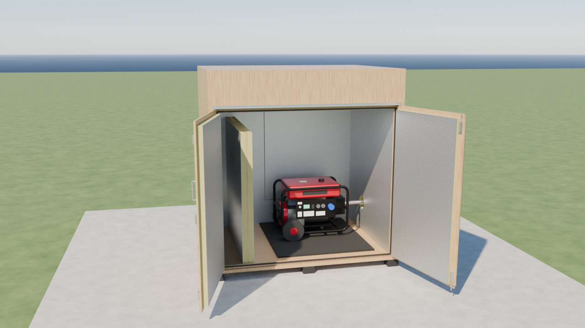
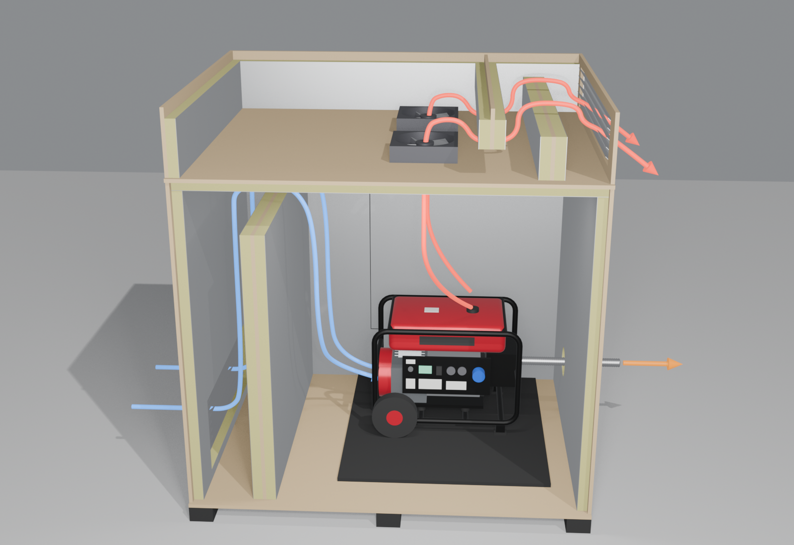
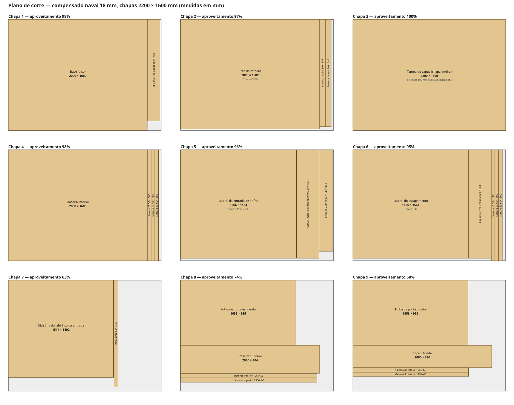

# Cabine acústica ventilada para gerador a gasolina

Projeto aberto de um abrigo externo em compensado naval para um gerador portátil de 7 kVA: reduz o ruído, mantém o motor ventilado e protege da chuva. O modelo 3D é **paramétrico** — um script Python gera tudo no Blender a partir das medidas — e vem com plano de corte das chapas e lista de materiais.

Foi dimensionado para o **Toyama TG8000CXER** (420 cc, 7,2 kVA, 820 × 680 × 650 mm), mas as medidas ficam em constantes no início do script e podem ser adaptadas a outros geradores.



> [!WARNING]
> **Este projeto ainda não foi construído nem medido.** É um estudo de projeto, não um produto testado.
>
> Um motor a gasolina dentro de uma caixa de madeira envolve risco de **intoxicação por monóxido de carbono, incêndio e superaquecimento**. A vazão de ar foi estimada por cálculo, não vem do fabricante nem de ensaio. Nunca instale em ambiente fechado ou junto a janelas e portas, não abasteça com o motor quente e use sensor de temperatura e detector de CO. Se for construir, valide com um profissional habilitado. O uso é por sua conta e risco.
>
> Projeto independente, sem vínculo com a Toyama.

## Como funciona



Olhando de frente para as portas:

1. **Entrada de ar frio (esquerda).** O ar entra por uma veneziana baixa na lateral, sobe por um duto formado por uma divisória revestida de lã de rocha e só chega à câmara por cima da divisória, a 1,50 m. Esse desvio impede que o som saia em linha reta pela veneziana.
2. **Câmara do gerador (centro).** Paredes, teto e portas levam 50 mm de lã de rocha (64 kg/m³) contida por tela perfurada. O gerador fica sobre tapete de borracha, com o painel voltado para as portas e o lado da ventoinha do motor voltado para a entrada de ar.
3. **Escapamento (direita).** O silencioso fica voltado para a parede direita. Os gases saem por um tubo flexível metálico que atravessa a parede por uma flange térmica, sem contato com a madeira.
4. **Saída de ar quente (em cima, à direita).** Dois exaustores axiais de 300 mm no teto puxam o ar quente para o capuz, onde duas chicanas alternadas formam um labirinto em "S" antes da veneziana de saída.

As portas são duplas, com batente em degrau, vedação em EPDM e mata-junta central.

| | |
|---|---|
| Medidas externas | 2.000 × 1.600 × 2.120 mm (largura × profundidade × altura) |
| Estrutura | compensado naval 18 mm, 9 chapas de 2.200 × 1.600 mm |
| Isolamento | lã de rocha 50 mm, 64 kg/m³, ~25 m² |
| Ventilação | 2 exaustores axiais de 300 mm, pressão negativa |
| Vazão necessária (estimativa) | 2.000 a 2.700 m³/h para o ar aquecer cerca de 15 °C |
| Menor área livre no caminho do ar | 0,141 m² (os dois exaustores) |

## O que há no repositório

| Arquivo | Conteúdo |
|---|---|
| `casa_gerador.py` | Script que gera o modelo 3D completo. As medidas ficam em constantes no início do arquivo. |
| `casa_gerador.blend` | Modelo já gerado, para abrir direto no Blender. |
| `plano_de_corte.py` | Posiciona as peças nas chapas, confere se cabem e não se sobrepõem, e desenha o plano. |
| `Especificações/projeto_cabine_acustica_gerador_toyama_tg8000cxer.md` | Descrição técnica do projeto: objetivos, arquitetura de ventilação, materiais e checklist de montagem. |
| `Especificações/plano_de_corte_e_materiais.md` | Lista de peças com medidas e recortes, lista de materiais e diferenças entre a descrição e o modelo 3D. |
| `Especificações/plano_de_corte.png` | Desenho das 9 chapas. |
| `renders/` | Vistas gerais, cortes com o fluxo de ar e vistas com e sem portas. |
| `renders_extra.py`, `renders_realista.py` | Geram vistas adicionais e vídeos de volta de 360°. |



## Como usar

Requer [Blender](https://www.blender.org/) (feito na versão 5.3) e Python 3.

Gerar o modelo e as imagens de corte:

```bash
blender --background --factory-startup --python casa_gerador.py -- --save casa_gerador.blend --render renders
```

Gerar o plano de corte (não precisa do Blender):

```bash
python3 plano_de_corte.py
```

Vistas adicionais e vídeos de 360°:

```bash
blender --background casa_gerador.blend --python renders_extra.py -- --imagens
blender --background casa_gerador.blend --python renders_realista.py -- --portas abertas
```

Para adaptar a outro gerador, altere as constantes no início de `casa_gerador.py` (medidas da caixa, envelope do gerador `GX, GY, GZ`, posição da flange do escapamento `EY, EZ`, venezianas e exaustores), gere o modelo de novo e ajuste as peças em `plano_de_corte.py`.

## Problemas conhecidos e pontos em aberto

- **Ruído do escapamento.** O gás de escape sai da cabine sem passar pelo tratamento acústico. Falta um segundo silencioso na linha externa.
- **Caminho do ar frio.** O ar entra na câmara a 1,50 m de altura e os exaustores ficam no teto, então parte dele pode passar por cima do gerador sem resfriá-lo. Falta um defletor que leve o ar até a ventoinha do motor.
- **Controle dos exaustores.** Devem ligar junto com o gerador e seguir alguns minutos após o desligamento. Falta termostato ou alarme de temperatura.
- **Cobertura.** A tampa do modelo é plana; na construção precisa de caimento de 3 a 5% e impermeabilização.
- **Plano de corte × modelo 3D.** O plano de corte usa três adaptações que ainda não estão no modelo: parede traseira em duas peças, teto da câmara 18 mm mais curto e folhas de porta com 1.658 mm de altura. Estão descritas em `Especificações/plano_de_corte_e_materiais.md`.
- **Descrição × modelo 3D.** A descrição técnica estima 5 a 6 chapas e 16 a 18 m² de lã; o modelo exige 9 chapas e cerca de 25 m². Quando houver diferença, valem as medidas do modelo.

Sugestões, correções e relatos de quem construir são bem-vindos nas *issues*.

## Licença

Scripts sob licença MIT. Textos, desenhos, imagens e o modelo 3D sob [CC BY 4.0](https://creativecommons.org/licenses/by/4.0/deed.pt-br). Veja `LICENSE`.
